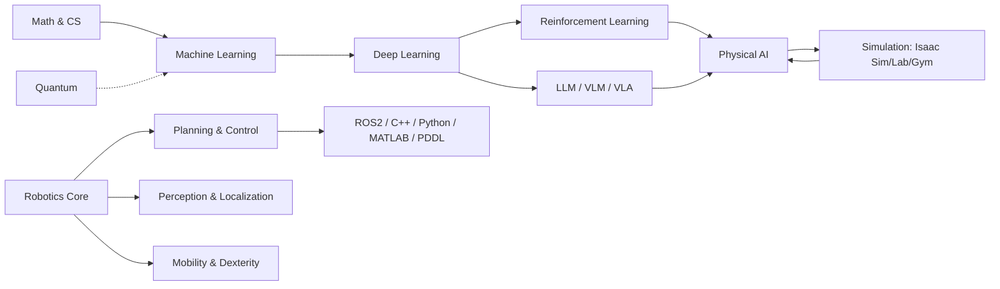

# Robotics & AI Bible

One place covering **ML → DL → RL → LLM/VLM/VLA → Quantum → Physical AI → Robotics (mobility, localization, dexterity, planning, control) → Software (ROS/ROS2, Python, C++, MATLAB, R, PDDL) → Simulation (Isaac Sim / Lab / Gym, MuJoCo, Gazebo)**.

Each chapter is written to answer three things fast:

1. **What is it?** (one-paragraph intuition)
2. **How does it work?** (equations / code you can write on a whiteboard)
3. **How will I be asked about it?** (interview Q&A at the bottom of each page)

## Reading plans

| Time before interview | What to read |
|---|---|
| **1 hour** | [Cheat sheets](../cheatsheets/formulas.md) + [Question bank](../interview/question-bank.md) skim |
| **1 day** | Role-specific path below + system-design page |
| **1 week** | Every chapter in your role path, write the code from memory |
| **Always** | [Story bank](../interview/behavioral.md) – your PhD/project stories |

## Role paths

| Target role | Path |
|---|---|
| **Robot learning / Physical AI** | RL → Imitation → VLA → Isaac Lab → Sim2Real → Manipulation |
| **Robotics software engineer** | C++ → ROS2 → Nav2 → TF/QoS → Control → Planning |
| **Perception / SLAM** | Geometry → Filters → SLAM → Localization → Sensors |
| **Humanoid / legged** | Dynamics → Whole-body control → Locomotion RL → Isaac Lab |
| **Manipulation / dexterity** | Kinematics → Grasping → MoveIt → Dexterous hands → Diffusion policy |
| **Quantum / research** | Quantum basics → Algorithms → VQE/QAOA → QML → Quantum robotics |
| **ML/LLM engineer** | ML → DL → Transformers → LLM training/inference → RAG/Agents |

## How to answer any technical question (the 5-step frame)

1. **Clarify** – constraints, scale, real-time? sim or real hardware?
2. **State the idea in one sentence** before any math.
3. **Give the formal version** – equation / pseudocode.
4. **Trade-offs & failure modes** – what breaks, when.
5. **Connect to experience** – “In my work on X, we saw…”.

:::tip Make it yours
Add a `## My experience` section at the bottom of any page with your own project examples. Interviewers remember stories, not definitions.
:::

## Chapter map

