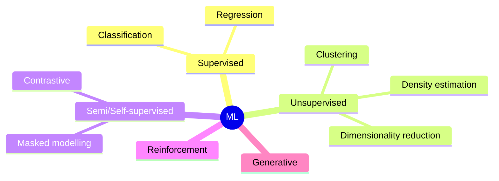

# Machine Learning Fundamentals

## Taxonomy

## Core ideas

- **Empirical risk minimization:** minimize $\frac1N\sum \ell(f_\theta(x_i),y_i)$ + regularizer.
- **Bias–variance:** $E[(y-\hat f)^2]=\text{Bias}^2+\text{Var}+\sigma^2$. Complex models: low bias, high variance. Double descent shows modern over-parameterized nets break the classical U-curve.
- **Generalization tools:** train/val/test split, k-fold CV, early stopping, regularization, data augmentation, ensembling.
- **Data leakage:** target info in features, time-series shuffling, normalizing before split, duplicate samples across splits.
- **Class imbalance:** reweighting, focal loss, resampling (SMOTE), PR-AUC rather than accuracy.

## Metrics

| Task | Metrics |
|---|---|
| Classification | accuracy, precision $\frac{TP}{TP+FP}$, recall $\frac{TP}{TP+FN}$, F1, ROC-AUC, PR-AUC, log-loss, calibration (ECE) |
| Regression | MSE, RMSE, MAE, R², Huber |
| Ranking | NDCG, MAP, MRR |
| Detection | IoU, mAP@[.5:.95] |
| Segmentation | mIoU, Dice |
| Trajectory/robot | ADE/FDE, success rate, collision rate, tracking RMSE |
| Generative | FID, perplexity, BLEU/ROUGE, human eval |

## Classical algorithms (know each in 60 s)

| Algorithm | Idea | Pros | Cons |
|---|---|---|---|
| Linear / Logistic regression | linear model; logistic = sigmoid + cross-entropy | interpretable, convex | linear boundary |
| k-NN | vote of k nearest | non-parametric | slow inference, curse of dimensionality |
| Naive Bayes | assume feature independence | fast, small data | independence wrong |
| SVM | max-margin; kernel trick $K(x,x')=\phi(x)^\top\phi(x')$ | strong in high-D small data | $O(n^2\!-\!n^3)$ training |
| Decision tree | recursive splits on Gini / entropy | interpretable | overfits |
| Random forest | bagging + random feature subsets | robust, little tuning | big, no extrapolation |
| Gradient boosting (XGBoost/LightGBM/CatBoost) | sequentially fit residual / gradient | SOTA on tabular | sensitive to hyper-params |
| k-means | Lloyd iterations minimizing within-cluster SSE | simple | spherical clusters, need k |
| GMM + EM | soft clustering, latent z | probabilistic | local optima |
| DBSCAN | density-based | arbitrary shapes, outliers | eps selection |
| PCA | top eigenvectors of covariance | decorrelates | linear |
| t-SNE / UMAP | non-linear embedding for viz | clusters | not for downstream distances |
| Gaussian Process | distribution over functions, kernel $k(x,x')$ | uncertainty, small data | $O(n^3)$ |
| HMM | latent Markov chain; forward, Viterbi, Baum–Welch | sequences | Markov assumption |

### Bagging vs boosting
Bagging reduces **variance** (parallel, independent trees). Boosting reduces **bias** (sequential, weighted/residual fitting).

### Logistic regression derivation
$p(y{=}1|x)=\sigma(w^\top x)$, loss $-\sum y\log p+(1-y)\log(1-p)$, gradient $X^\top(\sigma(Xw)-y)$.

### EM algorithm
E-step: compute posterior $q(z)=p(z|x,\theta^{t})$. M-step: $\theta^{t+1}=\arg\max E_q[\log p(x,z|\theta)]$. Monotonically increases likelihood (ELBO).

## Feature engineering & pipelines
Scaling (standardize for SVM/NN/kNN, not needed for trees), one-hot / target encoding, handling missing values, outlier clipping, feature selection (L1, mutual information, permutation importance), leakage-safe pipelines.

## Hyper-parameter tuning
Grid → random search → Bayesian optimization (Optuna) → Hyperband/ASHA. Always tune on validation, report on untouched test.

## Interview Q&A

**Bias vs variance fix?** High bias: bigger model, better features, train longer. High variance: more data, regularize, bagging, simpler model.

**Why standardize features?** Distance/gradient-based methods are scale-sensitive; speeds convergence.

**Precision vs recall for robot safety detector (pedestrian)?** Prioritize recall (miss = collision) then control false alarms with temporal filtering.

**Why does XGBoost beat NN on tabular data?** Heterogeneous features, small N, no smoothness prior; trees handle irregular decision boundaries & missing values.

**What is calibration?** Predicted probability matches empirical frequency. Fix with temperature scaling / isotonic regression.

**Explain cross-validation pitfalls for time series.** Use forward-chaining (expanding window); random folds leak the future.
