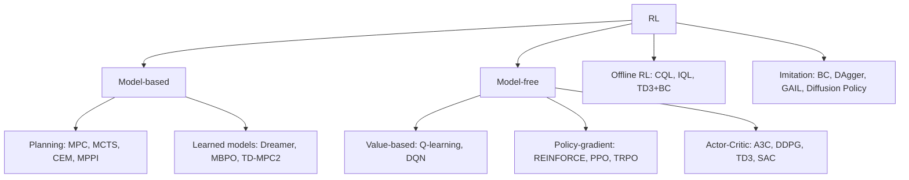

# Reinforcement Learning Foundations

## MDP
Tuple $(S,A,P,R,\gamma)$; Markov: $P(s'|s,a)$. Return $G_t=\sum_k\gamma^kr_{t+k+1}$. POMDP adds observations $O$; belief state or recurrent/transformer policy.

- Value: $V^\pi(s)=E_\pi[G_t|s]$, $Q^\pi(s,a)$, advantage $A=Q-V$.
- **Bellman expectation:** $V^\pi(s)=\sum_a\pi(a|s)\sum_{s'}P(s'|s,a)[r+\gamma V^\pi(s')]$
- **Bellman optimality:** $Q^*(s,a)=E[r+\gamma\max_{a'}Q^*(s',a')]$ — a $\gamma$-contraction ⇒ unique fixed point.

## Families

## Tabular / value methods
- **DP:** policy evaluation, policy iteration, value iteration (needs model).
- **Monte-Carlo:** unbiased, high variance, episodic.
- **TD(0):** $V(s)\leftarrow V(s)+\alpha[r+\gamma V(s')-V(s)]$; biased, low variance. TD(λ)/GAE interpolates.
- **SARSA** (on-policy) vs **Q-learning** (off-policy, max target).
- **DQN:** replay buffer + target network; Double DQN (fix over-estimation), Dueling, PER, Rainbow. Discrete actions only.

## Policy gradient
$\nabla_\theta J=E[\nabla\log\pi_\theta(a|s)\,\hat A]$ (policy-gradient theorem). Baseline reduces variance without bias.
- **REINFORCE** – MC return. **GAE(λ):** $\hat A_t=\sum(\gamma\lambda)^l\delta_{t+l}$, $\delta=r+\gamma V(s')-V(s)$ (bias–variance knob).
- **TRPO:** maximize surrogate s.t. $KL\le\delta$ (natural gradient, conjugate gradient).
- **PPO:** clipped surrogate
 $L=E[\min(r_t\hat A_t,\ \mathrm{clip}(r_t,1\pm\epsilon)\hat A_t)]$, $r_t=\pi_\theta/\pi_{old}$. + value loss + entropy bonus. Multiple epochs/minibatches per rollout. **The default for massively parallel sim (Isaac Lab/Gym, legged locomotion).**
- **A2C/A3C**, **IMPALA** (V-trace off-policy correction).

## Off-policy continuous control
| Algo | Key idea |
|---|---|
| DDPG | deterministic actor + Q critic, target nets, noise exploration |
| TD3 | twin critics (min), delayed actor, target policy smoothing |
| **SAC** | maximize reward + entropy $\alpha H(\pi)$; stochastic actor, twin Q, auto-tuned α; sample-efficient & robust |
| REDQ / DroQ / CrossQ | high UTD ratio, ensembles/regularized critics |

## Model-based RL
- Learn $\hat P(s'|s,a)$; plan with **MPC** (CEM, MPPI, iLQR) or imagine rollouts (Dyna, MBPO, Dreamer V3 latent world model, **TD-MPC2**). More sample-efficient; model bias is the risk (mitigate with ensembles, short rollouts).
- **MCTS / AlphaZero:** UCT $= Q+c\sqrt{\ln N/n}$; policy+value network guides search.

## Exploration
ε-greedy, Boltzmann, entropy bonus, UCB, Thompson sampling, count-based/RND/ICM curiosity, parameter-space noise, Go-Explore.

## Reward design & shaping
Sparse vs dense. Potential-based shaping $F=\gamma\Phi(s')-\Phi(s)$ preserves optimal policy. Reward hacking, curriculum, privileged info, reward = sum of weighted terms (tracking, energy, smoothness, termination).

## Offline RL & Imitation
- Distribution shift/extrapolation error: conservative (**CQL**), in-sample (**IQL**), BC-regularized (**TD3+BC**), sequence modelling (**Decision Transformer**).
- **BC** suffers compounding error $O(T^2\epsilon)$; **DAgger** queries expert on learner states $O(T\epsilon)$. **GAIL/AIRL** adversarial imitation. **Action chunking (ACT)** and **diffusion policy** handle multimodality & temporal consistency. See [Imitation & Robot Learning](../07-physical-ai/imitation-robot-learning.md).

## RLHF / alignment family (bridge to LLMs)
Reward model from preference pairs (Bradley–Terry) → PPO with KL penalty; **DPO** (closed-form, no RM/rollouts), **GRPO** (group-relative advantages, no critic, used for reasoning models), RLVR (verifiable rewards).

## Multi-agent, hierarchical, safe, meta
MARL: CTDE (MADDPG, QMIX, MAPPO). HRL: options, feudal, skill discovery (DIAYN). Safe RL: CMDP, Lagrangian, CPO, shielding, CBF filters. Meta-RL: MAML, RL², domain randomization as meta-learning.

## Interview Q&A

**On vs off-policy?** On-policy learns from data of current policy (PPO; stable, sample-hungry). Off-policy reuses replay (SAC; sample-efficient, less stable).

**Why PPO clip?** Limits policy ratio so large updates don't destroy performance; cheap approximation of trust region.

**Why advantage?** Subtract baseline → same expected gradient, lower variance.

**Bootstrapping & the deadly triad?** Function approximation + bootstrapping + off-policy ⇒ divergence risk.

**Why does DQN overestimate?** max over noisy estimates is positively biased → Double DQN decouples selection/evaluation.

**SAC vs PPO for robots?** SAC when real-world sample cost is high; PPO when you can run 4096+ envs in GPU sim.

**How do you debug RL?** Check reward scale, observation normalization, episode termination handling (time-out vs terminal → bootstrap correctly), seed variance, ablate to a trivial env, log entropy/KL/explained variance.
