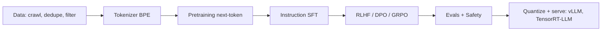

# LLMs End-to-End

## Pipeline

## Pretraining
- **Objective:** $\min -\sum\log p(x_t|x_{<t})$. Tokenization: BPE/SentencePiece/byte-level; vocab 32k–256k.
- **Scaling laws:** loss $L(N,D)\approx E+A/N^\alpha+B/D^\beta$; Chinchilla: ≈20 tokens/parameter compute-optimal; in practice over-train small models for cheap inference (LLaMA).
- **Architecture recipe (LLaMA-style):** RMSNorm pre-norm, RoPE, SwiGLU, GQA, no biases. **MoE:** router picks top-k experts per token (Mixtral, DeepSeek-V3) → big params, small active compute; issues: load balancing, expert parallel comms.
- **Data:** dedup (MinHash), quality classifiers, code & math mixes, synthetic data, curriculum, contamination checks.
- **Emergent abilities / in-context learning**, long context (RoPE scaling, ring attention).

## Post-training
1. **SFT** on instruction/response (mask prompt loss).
2. **Preference optimization:** RLHF (RM + PPO + KL), **DPO** $L=-\log\sigma(\beta[\log\frac{\pi(y_w)}{\pi_{ref}(y_w)}-\log\frac{\pi(y_l)}{\pi_{ref}(y_l)}])$, IPO, KTO, **GRPO** (group baseline), RLAIF/Constitutional AI.
3. **Reasoning models:** RL on verifiable rewards (math/code), long chain-of-thought, test-time compute scaling, process reward models, self-consistency, tree/best-of-N search.
4. **PEFT:** LoRA ($W+BA$, rank r≪d), QLoRA (4-bit base), prefix/prompt tuning, adapters.

## Inference & serving
- Prefill (compute-bound) vs decode (memory-bandwidth-bound). **KV cache**, paged attention (vLLM), continuous batching, speculative decoding (draft+verify), prefix caching, FlashAttention.
- **Quantization:** INT8/INT4 (GPTQ, AWQ), FP8, KV-cache quant; weight-only vs W8A8.
- Sampling: greedy, beam, temperature, top-k, top-p (nucleus), min-p, repetition penalty, constrained/grammar decoding for JSON/tools.
- Latency metrics: TTFT, inter-token latency, tokens/s, throughput per GPU.

## Applications
- **Prompting:** zero/few-shot, CoT, ReAct, self-refine, structured outputs.
- **RAG:** chunk → embed → vector DB (FAISS/pgvector/Milvus) → retrieve (+ rerank, hybrid BM25) → generate with citations. Failure modes: bad chunking, retrieval miss, lost-in-the-middle, stale index. Evaluate with recall@k, faithfulness, answer relevance.
- **Agents:** LLM + tools + memory + planner loop; function calling; MCP (Model Context Protocol); multi-agent; guardrails; eval harnesses (SWE-bench, tau-bench).
- **Robotics uses:** task planning (SayCan, Code-as-Policies, Inner Monologue), PDDL generation (LLM+P), reward design (Eureka), scene reasoning, natural-language interfaces to ROS.

## Evaluation & safety
Benchmarks (MMLU, GSM8K, HumanEval, GPQA, SWE-bench), LLM-as-judge pitfalls (position/verbosity bias), contamination, hallucination types (intrinsic/extrinsic), jailbreaks, prompt injection, red-teaming, alignment tax.

## Interview Q&A

**Why is decoding memory-bound?** One token per step → each step reads all weights + KV for tiny arithmetic; batching amortizes weight reads.

**LoRA why it works?** Task updates have low intrinsic rank; train $r(d+k)$ instead of $dk$ parameters; mergeable at inference.

**Hallucination mitigation?** RAG, tool use, constrained decoding, calibrated abstention, verification/self-consistency, RLHF on factuality.

**DPO vs PPO-RLHF?** DPO is offline, simple, no RM/sampling; PPO-RLHF is online, can exploit RM, higher ceiling/complexity.

**Why top-p?** Truncates unreliable tail dynamically vs fixed k.

**Compute for training?** ≈ $6ND$ FLOPs (N params, D tokens).
