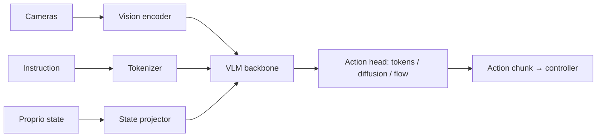

# Vision-Language Models → Vision-Language-Action Models

## VLM
A VLM maps (image(s), text) → text. Components: **vision encoder** (CLIP/SigLIP/DINOv2 ViT) → **connector/projector** (linear/MLP, Q-Former, perceiver resampler, cross-attention) → **LLM**.

| Model | Notes |
|---|---|
| CLIP / SigLIP | contrastive dual encoder (SigLIP: sigmoid loss, no global softmax) |
| Flamingo | frozen LLM + gated cross-attn |
| BLIP-2 | Q-Former bridge |
| LLaVA | CLIP + MLP + Vicuna, visual instruction tuning |
| PaLI / PaliGemma | encoder–decoder / Gemma, SigLIP |
| Qwen-VL, InternVL, Gemini, GPT-4V-class | native multimodal |
| Molmo, SmolVLM | open, pointing/grounding |

Training stages: (1) align projector on caption pairs, (2) full multimodal pretraining, (3) visual instruction tuning, (4) preference tuning. Challenges: hallucination (object), resolution/any-res tiling, OCR/charts, spatial reasoning, video token explosion (frame sampling, token merging).

Open-vocab perception in robotics: **GroundingDINO, OWL-ViT, SAM/SAM2, CLIPSeg, Detic, VLMaps, ConceptFusion, OK-Robot**.

## VLA — Vision-Language-Action
Policy $\pi(a_{t:t+H}\mid I_{t},\ \ell,\ q_t)$: images + language instruction + proprioception → robot actions.

### Action representation
| Method | Models | Trade-off |
|---|---|---|
| **Discrete tokens** (binning each dim to 256 bins; or FAST — DCT-based compression) | RT-2, OpenVLA, π0-FAST | reuses LLM head; slow & coarse at high frequency |
| **Regression head** | RT-1, Octo (diffusion head option) | simple, unimodal |
| **Diffusion / flow-matching action expert** | π0, Octo, GR00T N1, Diffusion Policy | continuous, multimodal, chunked; extra denoise steps |
| **Action chunking** | ACT, π0, GR00T | smooth, fewer queries, temporal ensembling |

### Landmark systems (chronological)
- **SayCan** (LLM affordance grounding), **PaLM-E** (embodied multimodal), **RT-1** (transformer on 130k demos), **RT-2** (web + robot co-fine-tuning; actions as text tokens), **Open X-Embodiment / RT-X** (cross-embodiment dataset, 22 robots), **Octo** (generalist diffusion transformer), **OpenVLA** (7B, Llama2 + DINOv2+SigLIP, open), **π0 / π0.5** (PaliGemma + flow-matching action expert, 50 Hz chunks, hierarchical reasoning), **Helix** (Figure; System 2 slow VLM + System 1 fast visuomotor), **GR00T N1** (NVIDIA humanoid; dual-system, Eagle VLM + DiT action head, trained on real+sim+video "neural trajectories"), **Gemini Robotics** (+ER embodied reasoning), **SmolVLA** (small, low-cost), **LBM** (Toyota Research large behavior models).
- **Dual-system design:** slow reasoning VLM (≈7–10 Hz) + fast action policy (≈100–200 Hz).

### Data
Teleoperation (leader-follower ALOHA, VR, spacemouse, exoskeleton), UMI grippers (in-the-wild), human video (Ego4D, Ego-Exo, EgoDex), simulation + synthetic (MimicGen, DexMimicGen, GR00T-Dreams), datasets: Open-X, DROID, BridgeData V2, LIBERO, RoboCasa, AgiBot World. Cross-embodiment: unify action space, per-embodiment heads, normalizing stats.

### Training recipe
1. Pretrain VLM (web). 2. Co-train on robot data + web VQA (prevents forgetting). 3. Post-train/fine-tune on target tasks (LoRA, few hundred demos). 4. RL fine-tuning / residual RL / human-in-the-loop (HIL-SERL, RLinf, π*0.6 with Recap). 5. Deploy: quantize, async inference, real-time chunking.

### Evaluation
Success rate across seeds/trials, generalization axes (object, language, visual, position, embodiment), benchmarks: **LIBERO, SimplerEnv, CALVIN, RoboCasa, ManiSkill, BEHAVIOR-1K**; real-world A/B with many trials; failure taxonomy.

### Open problems
Inference latency, long-horizon memory, precise/contact-rich manipulation, force/tactile modality, reasoning-vs-acting alignment, safety, data scaling laws for robotics, evaluation reproducibility, world-model-based policy evaluation.

## World models & video
Predictive models of environment: Dreamer, GAIA, Genie, **NVIDIA Cosmos** (world foundation models: Predict/Transfer/Reason; used for synthetic data & policy eval), V-JEPA 2, UniSim, 1X world model. Use cases: planning, data augmentation, policy evaluation without hardware.

## Interview Q&A

**VLM vs VLA?** VLM outputs text; VLA outputs actions (embodied), trained with robot trajectories.

**Why not just output joint torques from an LLM?** Latency, precision and safety: LLM at ≈5–10 Hz can't close a 100+ Hz loop → chunking + fast low-level controller.

**Why flow matching/diffusion head in π0?** Continuous high-dimensional, multimodal chunks (50 steps) without discretization error; denoise with few steps.

**How does RT-2 transfer web knowledge?** Co-train on VQA + robot data; actions become tokens in the same vocabulary, so semantic reasoning ("pick the extinct animal") carries to control.

**Failure modes of VLAs?** Language ignorance (follows visual prior), poor spatial precision, out-of-distribution lighting/objects, covariate shift, slow recovery behaviors.

**How would you add tactile/force to a VLA?** Extra encoder tokens for tactile arrays/wrench history, or a low-level compliance/impedance layer under the VLA; train with contact-rich data.
