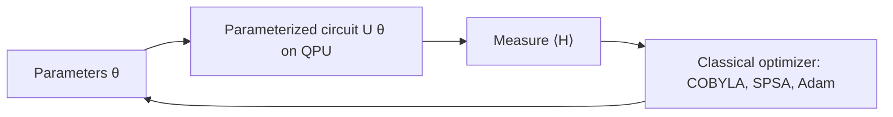

# Quantum Algorithms

## Landscape

| Algorithm | Problem | Speed-up | Notes |
|---|---|---|---|
| Deutsch–Jozsa / Bernstein–Vazirani / Simon | oracle problems | exp. (query) | historical; Simon inspired Shor |
| **QFT** | Fourier transform | $O(n^2)$ gates vs $O(n2^n)$ | subroutine |
| **Phase estimation (QPE)** | eigenvalue of U | – | basis for Shor, HHL, chemistry |
| **Shor** | factoring / discrete log | super-polynomial | breaks RSA/ECC → post-quantum crypto (Kyber, Dilithium) |
| **Grover** | unstructured search | quadratic $O(\sqrt N)$ | amplitude amplification; optimal |
| **HHL** | linear systems | exp. *under caveats* | needs sparse A, state prep, readout only of observables |
| Quantum walks | graph search | poly/exp | |
| **Hamiltonian simulation** | $e^{-iHt}$ | exp. | Trotter, qubitization, LCU → chemistry/materials (killer app) |
| **VQE** | ground-state energy | heuristic | NISQ |
| **QAOA** | combinatorial opt. | heuristic | NISQ |
| Quantum annealing | QUBO/Ising | heuristic | D-Wave |
| Boson sampling / RCS | sampling supremacy | exp. (no application) | Google Sycamore 2019 |

## Complexity classes
BQP (bounded-error quantum poly time) ⊇ P, ⊆ PSPACE. Believed BQP ⊉ NP-complete. Quantum advantage claims need care about best classical algorithm (dequantization of recommender/QML results by Tang).

## Grover in detail
Oracle flips phase of marked $|w\rangle$; diffusion reflects about mean $2|s\rangle\langle s|-I$. Each iteration rotates state by $2\theta$, $\sin\theta=\sqrt{M/N}$; optimal iterations ≈ $\frac\pi4\sqrt{N/M}$ (over-rotation reduces success).

## Shor in detail
Factor N → find period $r$ of $f(x)=a^x\bmod N$ via QPE/QFT on modular exponentiation → $\gcd(a^{r/2}\pm1,N)$. Needs ≈ thousands of logical qubits for RSA-2048 (Gidney 2025 estimate: under 1 million noisy qubits, roughly a week of runtime).

## Variational quantum algorithms (VQA)

- **VQE:** minimize $E(\theta)=\langle\psi(\theta)|H|\psi(\theta)\rangle\ge E_0$ (variational principle). Ansätze: UCCSD (chemistry), hardware-efficient, ADAPT-VQE. Hamiltonian decomposed into Pauli strings (Jordan–Wigner / Bravyi–Kitaev mapping). Gradients via **parameter-shift rule** $\partial_\theta f=\frac12[f(\theta+\frac\pi2)-f(\theta-\frac\pi2)]$.
- **QAOA (depth p):** $|\gamma,\beta\rangle=\prod e^{-i\beta_kH_M}e^{-i\gamma_kH_C}|+\rangle^n$. Max-Cut → Ising $H_C=\sum\frac12(1-Z_iZ_j)$. Approximation ratio improves with p.
- **Challenges:** **barren plateaus** (gradient variance vanishes exponentially with qubits/depth for random circuits → use local cost, good init, structured ansatz), noise-induced plateaus, shot noise, optimizer local minima, measurement cost.
- **QUBO/Ising mapping:** binary $x_i=(1-z_i)/2$; $\min x^\top Qx$.

## Quantum machine learning (QML)

- **Encodings:** basis, amplitude ($2^n$ values in n qubits, expensive to load), angle, IQP/ZZ feature map.
- **Quantum kernels:** $k(x,x')=|\langle\phi(x)|\phi(x')\rangle|^2$ + classical SVM. **Variational quantum classifiers** / quantum neural nets (QNN), **quantum GANs**, **QCNN**, quantum reservoir computing, **quantum Boltzmann machines**.
- **Honest assessment:** no proven practical advantage on classical data yet; data loading and readout bottlenecks; dequantization; potential advantage on quantum data (physics, chemistry) and certain structured kernels. Trainability (barren plateaus) and classical-simulability (Cerezo et al.) are active research.

## Quantum for robotics (research directions — relate to your PhD)
- **Planning/optimization:** path planning, task allocation, multi-robot scheduling as QUBO on annealers/QAOA; Grover-style search over configurations.
- **Quantum RL:** variational circuits as policy/value functions; quantum-enhanced exploration.
- **Perception/ML:** QSVM/QCNN for sensor classification; quantum kernels on small data.
- **Sensing:** quantum magnetometers, atomic clocks, quantum gyroscopes/accelerometers (cold-atom interferometry) → GPS-denied navigation; quantum LiDAR/radar (entanglement-enhanced).
- **Control/estimation:** quantum Kalman filtering is a classical analog for quantum systems; quantum control (GRAPE, Krotov) for pulse-level gates; RL for calibration.
- **Communication/security:** QKD for robot-swarm links, post-quantum crypto for fleet security.
- **Space robotics:** quantum comms/sensing for satellites.

## Interview Q&A

**Why is Grover optimal?** BBBV theorem: any quantum algorithm needs $\Omega(\sqrt N)$ queries.

**What breaks if the oracle is expensive?** Speed-up counted in oracle queries; implementing the oracle (e.g. QRAM) may cost $O(N)$.

**Explain barren plateaus.** For random parametrized circuits (2-design), $\mathrm{Var}[\partial C]\sim 2^{-n}$ → exponentially flat landscape; need shallow/local/structured circuits.

**Why parameter-shift instead of finite difference?** Exact on hardware, robust to shot noise scale.

**Is VQE guaranteed to find ground state?** No: ansatz expressibility, optimizer local minima, noise — only upper bound.

**QUBO to Ising?** Substitute $x=(1+s)/2$ with $s\in\{\pm1\}$ → couplings $J_{ij}$ and fields $h_i$ → map $s\to Z$ operators.
