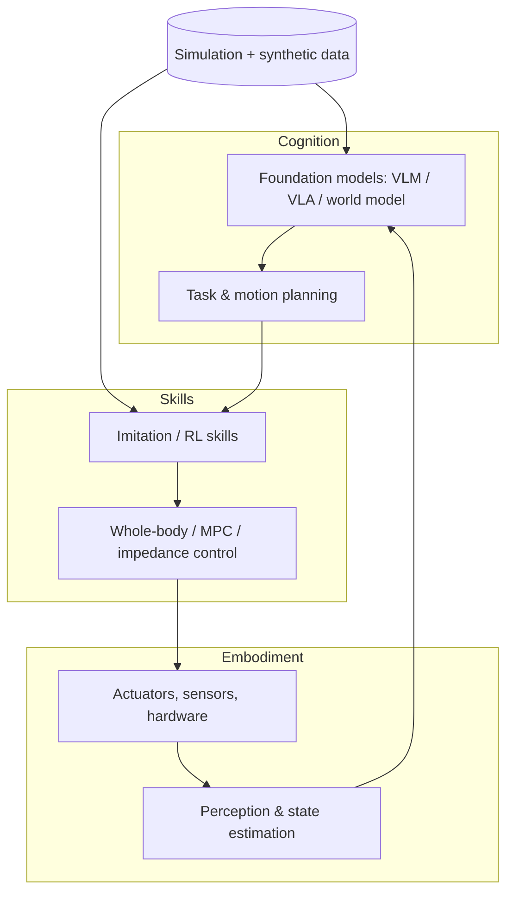

# Physical AI

**Physical AI** = AI systems that perceive, reason and act in the physical world through a body (robots, AVs, drones, industrial machines), trained heavily in simulation and from real/human data.

## The three-computer view (NVIDIA framing)
1. **Train** – DGX/GPU clusters: foundation models (GR00T, Cosmos), policies.
2. **Simulate / generate data** – Omniverse + Isaac Sim/Lab + Cosmos (digital twins, synthetic data, policy evaluation).
3. **Run at the edge** – Jetson Thor/AGX Orin: real-time inference (TensorRT, Isaac ROS).

## Stack

## Why it is hard (Moravec's paradox & friends)
- **Data scarcity**: no internet-scale action data → teleop, sim, human video, cross-embodiment pooling.
- **Sim-to-real gap**: dynamics, contact, sensor noise, latency, actuator models.
- **Real-time & safety**: closed-loop at 100–1000 Hz; failures damage hardware/people.
- **Partial observability, contact-rich dynamics, long-horizon tasks**, non-stationary environments.
- **Evaluation**: expensive, non-reproducible, success-rate statistics need many trials.

## Embodiments
Manipulators (arms, grippers, dexterous hands), mobile manipulators, quadrupeds (Spot, Go2, ANYmal), humanoids (Atlas, Optimus, Figure, Digit, Unitree H1/G1, Apptronik Apollo, 1X NEO, Fourier GR-1, Booster), drones/UAVs, AVs, underwater/space robots, soft robots, surgical robots.

## Paradigms for building behaviour
| Paradigm | Strength | Weakness |
|---|---|---|
| Classical (model-based planning + control) | guarantees, interpretable | brittle to perception, hard to scale tasks |
| RL in sim | agility, robustness (locomotion) | reward design, sim gap |
| Imitation / VLA | task diversity, language | needs demonstrations, covariate shift |
| Hybrid (VLM planner + learned skills + classical safety) | practical today | integration complexity |

**Industry trend:** end-to-end VLA for manipulation + RL for locomotion + classical safety/whole-body layer.

## Interview Q&A

**What is Physical AI vs "embodied AI"?** Largely synonyms; "Physical AI" emphasizes deployment, sim-based data generation and foundation models for the real world.

**Why simulation first?** Safety, 1000× parallelism, privileged info, resets, domain randomization, cost.

**Is end-to-end enough for manipulation?** Works for many tasks with enough data; still lacks guarantees on safety and force-limited contact → keep reactive safety layers.
