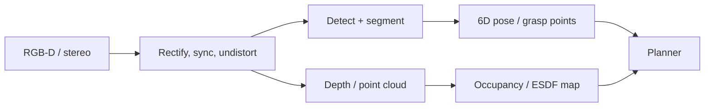

# Robot Perception

## Task menu
| Task | Methods |
|---|---|
| Detection | YOLOv8–v12, RT-DETR, Faster R-CNN; open-vocab GroundingDINO, OWLv2, YOLO-World |
| Segmentation | Mask R-CNN, **SAM / SAM 2**, Mask2Former, OneFormer; panoptic |
| Depth | stereo (RAFT-Stereo, FoundationStereo), monocular (Depth Anything v2, Metric3D, UniDepth) |
| Optical flow / tracking | RAFT, CoTracker, TAPIR, SAM2 video, ByteTrack/DeepSORT (MOT) |
| 6D object pose | FoundationPose, MegaPose, DenseFusion, PVN3D, GDR-Net; category-level NOCS |
| Keypoints / affordances | DINOv2 features, Where2Act, VRB |
| 3D detection | PointPillars, CenterPoint, BEVFusion, BEVFormer, SECOND |
| 3D understanding | PointNet/PointNet++, Point Transformer, Sparse conv (MinkowskiNet), OpenScene, LERF |
| Scene reconstruction | NeRF, 3D Gaussian Splatting, TSDF fusion, COLMAP SfM/MVS |
| Human pose / hands | OpenPose, MediaPipe, HaMeR, MANO; retargeting for teleop |
| Grasp perception | GraspNet-1B, Contact-GraspNet, AnyGrasp, GraspGen |

## Camera model & geometry reminders
Pinhole projection, distortion (radial/tangential, fisheye Kannala-Brandt), undistortion, depth→point cloud $X=(u-c_x)Z/f_x,\ Y=(v-c_y)Z/f_y$, extrinsic transforms, depth alignment to RGB, point-cloud filtering (voxel downsample, statistical outlier, RANSAC plane segmentation, Euclidean clustering).

## Perception pipelines in robots

Production perception: TensorRT/ONNX optimization, FP16/INT8, **Isaac ROS** GPU-accelerated nodes (NITROS zero-copy), DeepStream, batching, latency budget, time-stamped TF, failure monitoring (confidence, out-of-distribution detection).

## Robustness
Domain shift (lighting, textures), transparent/reflective objects (use stereo/learned depth completion e.g. ClearGrasp, LIDF), motion blur, occlusion, long-tail objects, sensor degradation, adversarial robustness; test-time adaptation; uncertainty (ensembles, MC dropout, conformal prediction).

## Datasets
COCO, LVIS, ImageNet, KITTI, nuScenes, Waymo Open, ScanNet, Replica, YCB-Video, BOP, Objaverse, EPIC-Kitchens, Ego4D, OpenImages.

## Interview Q&A

**IoU / mAP definitions?** IoU = |A∩B|/|A∪B|; AP = area under PR curve per class at IoU threshold; mAP average across classes (and thresholds).

**NMS?** Suppress overlapping boxes with lower scores; DETR removes it via bipartite matching.

**Why SAM matters for robotics?** Promptable zero-shot masks → grasp targets, object-centric representations, auto-labeling.

**Stereo vs ToF?** Stereo passive, long range, textureless fails; ToF active, dense indoors, sunlight/multipath issues.

**How do you get 6D pose from one RGB-D image?** Segment object → match to CAD (model-based: FoundationPose render-and-compare) or regress pose; refine with ICP.
