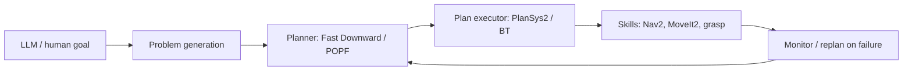

# Task Planning & PDDL

## Classical AI planning
State = set of propositions; actions with preconditions/effects; goal condition. Complexity: PSPACE-complete (propositional STRIPS). Search: forward state-space (progression), regression, plan-space (POP); heuristics from **delete relaxation** ($h_{add}$, $h_{max}$, FF), landmarks, pattern databases. Planners: **Fast Downward** (LAMA), FF, Metric-FF, OPTIC, POPF, ENHSP, SMTPlan, LPG, VAL (validator), **PlanSys2** (ROS2), ROSPlan.

## PDDL (Planning Domain Definition Language)

### Domain
```lisp
(define (domain pick-place)
  (:requirements :strips :typing :negative-preconditions)
  (:types robot location obj)
  (:predicates
    (at ?r - robot ?l - location)
    (obj-at ?o - obj ?l - location)
    (holding ?r - robot ?o - obj)
    (hand-empty ?r - robot)
    (connected ?a ?b - location))

  (:action move
    :parameters (?r - robot ?from ?to - location)
    :precondition (and (at ?r ?from) (connected ?from ?to))
    :effect (and (not (at ?r ?from)) (at ?r ?to)))

  (:action pick
    :parameters (?r - robot ?o - obj ?l - location)
    :precondition (and (at ?r ?l) (obj-at ?o ?l) (hand-empty ?r))
    :effect (and (holding ?r ?o) (not (obj-at ?o ?l)) (not (hand-empty ?r))))

  (:action place
    :parameters (?r - robot ?o - obj ?l - location)
    :precondition (and (at ?r ?l) (holding ?r ?o))
    :effect (and (obj-at ?o ?l) (hand-empty ?r) (not (holding ?r ?o)))))
```

### Problem
```lisp
(define (problem deliver-box)
  (:domain pick-place)
  (:objects r1 - robot a b c - location box - obj)
  (:init (at r1 a) (obj-at box b) (hand-empty r1)
         (connected a b) (connected b a) (connected b c) (connected c b))
  (:goal (obj-at box c)))
```
Run: `fast-downward.py domain.pddl problem.pddl --search "astar(lmcut())"`.
Plan: `move r1 a b → pick r1 box b → move r1 b c → place r1 box c`.

### PDDL versions & features
- **PDDL 2.1:** numeric fluents, durative actions (`:durative-action`, `at start/over all/at end`) for temporal planning; **2.2:** derived predicates, timed initial literals; **3.0:** preferences, trajectory constraints; **PDDL+** continuous processes/events. **PDDL 1.2/ADL:** `:adl` conditional effects, quantified `forall/exists`, disjunctive preconditions.
- Related: **HTN** (SHOP2, HDDL), **PPDDL / RDDL** (probabilistic), **FOND** (non-determinism), **POMDP** planners, **LTL goals / reactive synthesis**, **PDDLStream** (continuous sampling streams for TAMP).

### Typical modelling pitfalls
Missing frame axioms (effects must remove old facts), symmetrical objects causing blow-up, using numeric fluents when planner doesn't support, unreachable goals due to forgotten preconditions, grounding explosion (reduce object counts, use types).

## From plan to robot: execution

**PlanSys2** provides domain/problem expert, planner (POPF), executor, and BT-based action performers (`ActionExecutorClient`) in ROS2.

## Behavior Trees (BT)
Tree of nodes ticked at fixed rate: **Sequence** (→, AND), **Fallback/Selector** (?, OR), **Parallel**, **Decorators** (Retry, Timeout, Inverter), **Action**/**Condition** leaves; blackboard shared memory. Return SUCCESS/FAILURE/RUNNING. Advantages over FSM: modular, reusable, reactive, no transition explosion. Libraries: **BehaviorTree.CPP** (v4, Groot2 visualizer; used in Nav2), py_trees (ROS), Unreal/Unity BT. Compare: FSM (SMACH, FlexBE, YASMIN), HTN, hierarchical FSM, utility AI, GOAP.

```xml
<root BTCPP_format="4"><BehaviorTree ID="Main">
  <Sequence>
    <Action ID="NavigateTo" goal="{pick_pose}"/>
    <Fallback>
      <Action ID="Grasp"/>
      <RetryUntilSuccessful num_attempts="3"><Action ID="RegraspWithNewView"/></RetryUntilSuccessful>
    </Fallback>
    <Action ID="NavigateTo" goal="{place_pose}"/>
    <Action ID="Place"/>
  </Sequence>
</BehaviorTree></root>
```

## LLMs + planning
LLM as translator (NL→PDDL: **LLM+P**, **LLM-DP**), as planner (SayCan, Inner Monologue, ProgPrompt, Code-as-Policies), with verifier loop (VAL / simulator feedback), neuro-symbolic hybrids; LLM failure modes: invalid preconditions, hallucinated objects, poor long-horizon consistency → use symbolic validation.

## Interview Q&A

**STRIPS vs PDDL?** PDDL is a standardized language extending STRIPS (types, conditions, numerics, time).

**Why delete relaxation?** Ignoring delete effects gives a tractable (still NP-hard optimal, poly satisficing) relaxation; admissible with $h^+$, informative for FF.

**BT vs FSM?** BT composes via hierarchy, avoids N² transitions, easier reuse & reactivity.

**How handle action failure?** Monitor effects, update world state, replan (online), BT fallback, contingency planning (FOND).

**Why combine TAMP?** Symbolic feasibility ignores geometry (reachability, collision); motion planner validates and returns continuous parameters.
