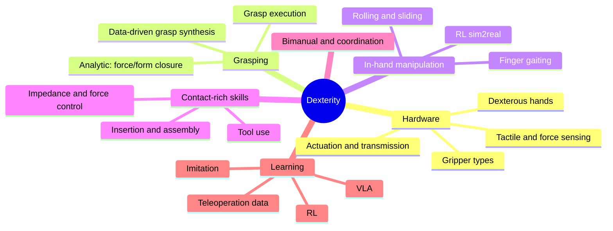

# Manipulation & Dexterity

**Dexterity** = ability to skillfully control object pose and contact with the hand: grasping, in-hand manipulation, tool use, bimanual coordination, contact-rich assembly.

## Breakdown (what an interviewer expects)

## Hardware
| Type | Examples | Notes |
|---|---|---|
| Parallel-jaw | Robotiq 2F, Franka hand, OnRobot | robust; most industrial |
| Suction / vacuum | Schmalz, Piab | warehouse picking |
| Soft / underactuated / adaptive | Robotiq 3F, SoftHand, Fin-Ray | passive adaptation |
| Anthropomorphic dexterous hands | **Shadow Hand (20 DOF)**, Allegro (16), LEAP Hand (16, low-cost), Inspire/Ability/Sharpa/Wuji, Tesla Optimus, Figure, DexHand, UMI-gripper | many DOF; tendon vs direct drive; reliability/cost |
| Tool changers / special | needle, welding | |

Hand design: DOF vs underactuation, joint torque density, backdrivability, tactile coverage, fingertip compliance (rubber pads increase friction), thumb opposition. Thumb accounts for ~40% of hand function.

## Grasp theory
- **Contact models:** point contact (no friction), point contact with friction (Coulomb cone $\|f_t\|\le\mu f_n$), soft-finger (torsional).
- **Grasp matrix** $G$ maps contact forces to object wrench: $w=Gf$. **Force closure:** can resist any external wrench with positive contact forces; **form closure** is geometric (kinematic) closure.
- **Quality metrics:** Ferrari–Canny $\epsilon$ (largest ball in the grasp wrench space), volume of GWS, manipulability, robustness to pose error, task wrench space.
- Antipodal grasp: two contacts with normals aligned within friction cone.

## Grasp synthesis & perception
Analytic (GraspIt!, Dex-Net 1–4 / GQ-CNN), 6-DOF deep learning (Contact-GraspNet, AnyGrasp, GraspNet-1B, GraspGen, Graspness), transparent/reflective handling, learned affordances, language-conditioned (LERF-TOGO, GraspGPT), sim-generated datasets (Objaverse + physics). Execution: pre-grasp approach, compliant closing (current/force thresholds), lift test, regrasp planning.

## In-hand manipulation
Methods: finger gaiting/ rolling/ sliding primitives, model-based (contact-implicit MPC), **RL in simulation with domain randomization** (OpenAI Dactyl Rubik's cube, Isaac Gym AllegroHand, **DeXtreme**), visual/proprioceptive teacher-student, **tactile-based in-hand rotation** (Hora, AnyRotate, Penspin), single-camera/rotation of arbitrary objects, human video retargeting (DexMV, DexPilot, AnyTeleop). Key obstacles: sim contact fidelity, reward design, hardware wear, partial observability of object pose (occlusion → tactile).

## Contact-rich manipulation
Peg-in-hole (search spiral, compliance, RCC), assembly (FMB, Factory/ IndustReal benchmarks in Isaac), cable/ deformable (cloth folding, rope, dough), liquid pouring, tool use. Controls: impedance/admittance, hybrid force/position, force-torque thresholds; learning residual policies on top of compliance controller; tactile feedback (slip detection via vibration/shear).

## Bimanual & whole-body
ALOHA/Mobile ALOHA, ACT/diffusion for bimanual, constraint-coupled manipulation (closed kinematic chain), task coordination (leader–follower, symmetric), humanoid loco-manipulation.

## Learning pipeline summary
1. **Data**: teleop (gloves, VR, exoskeleton, GELLO), human video, sim generation. 2. **Policy**: diffusion policy / ACT / VLA with action chunking. 3. **Fine-tune**: RL (HIL-SERL) for reliability/speed. 4. **Safety layer**: impedance limits, force thresholds. 5. **Evaluation**: >50 trials/task, report failure modes.

## Evaluation benchmarks
YCB object set, Dex-Net, GraspNet-1B, ManiSkill3, RLBench, LIBERO, Meta-World, robosuite, RoboCasa, DexMV, Bi-DexHands, DexArt, BEHAVIOR-1K, Factory (Isaac), FMB, NIST assembly task boards.

## Interview Q&A

**Force vs form closure?** Form: geometric immobilization without friction; force: relies on friction to resist wrenches.

**Why are dexterous hands hard to control with RL?** High-dimensional, hybrid contact dynamics, sparse reward, sim contact mismatch, and exploration; mitigated by structured action spaces, tactile, demos.

**Why tactile sensing?** Vision is occluded at contact; tactile gives contact location, force, slip → critical for in-hand and insertion.

**Underactuated hands pros/cons?** Adaptive and simple, but less precise & harder to model.

**How would you design a pick-and-place system in a bin?** Perception (RGB-D, segmentation) → grasp proposals → collision-free approach (MoveIt/CuRobo) → force-aware close → verify (weight / vision) → place → exception handling & retries; measure picks/hour, success rate.

**What makes insertion hard?** Clearance < pose uncertainty; solve via compliance + search/learning, visual servoing, force feedback.
