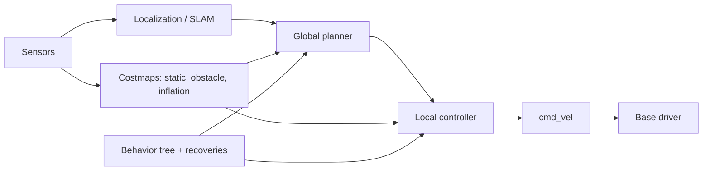

# Mobility

"Mobility" = ability of the robot body to traverse environment. Break down by **locomotion modality → kinematics/dynamics → perception/localization → planning → control → safety**.

## Locomotion modalities
| Modality | Platforms | Key issue |
|---|---|---|
| Wheeled (diff-drive, Ackermann, skid-steer, mecanum/omni, swerve) | AMRs, AGVs, cars | slip, nonholonomy |
| Tracked | rescue, military | skid steer, terrain |
| Legged | biped, quadruped, hexapod | balance, contact scheduling → see [Legged](./legged-locomotion.md) |
| Aerial | quadrotor, fixed-wing, VTOL | underactuation, wind, battery |
| Aquatic | AUV/ROV, USV | comms, buoyancy |
| Space | free-flyers, orbital manipulators, rovers | microgravity, comms delay |
| Hybrid | wheel-legged (Ascento, Tron), climbing | mode switch |

## Navigation pipeline

### Local planners
- **Pure pursuit** (look-ahead point), **Stanley** (cross-track + heading), **Regulated Pure Pursuit** (Nav2: speed regulation near obstacles/curves).
- **DWA:** sample $(v,\omega)$ in dynamic window, forward-simulate, score (goal, clearance, speed).
- **TEB:** elastic band optimization with time.
- **MPC/MPPI:** sample many trajectories, weight by cost, average; handles non-linear & arbitrary costs.
- Social navigation: pedestrian prediction, social force, interaction-aware RL/MPC.

### Costmap
Layered grid: inflation radius ≥ robot circumscribed radius; footprint collision check; keepout/speed zones; 3D (voxel, ESDF) for legged/aerial.

### Frames in a mobile stack
`map → odom → base_link → sensors`. `odom` continuous but drifting; `map→odom` jumps from localization. (REP-105)

## Mobile manipulation
Whole-body: base + arm treated jointly; base positioning for reachability (inverse reachability maps), "navigate then manipulate" vs simultaneous; examples: Stretch, Fetch, TIAGo, Spot-arm, Mobile ALOHA, mobile humanoids. Challenges: base uncertainty vs. precise manipulation → visual servoing/fiducials, arm compensation.

## Aerial specifics (UAV)
Quadrotor dynamics: $m\ddot p=-mge_3+R f e_3$, $J\dot\omega=\tau-\omega\times J\omega$. Differential flatness (positions + yaw) → minimum-snap trajectories. Cascaded control: position → attitude → rate → motor mix (PX4, ArduPilot). Estimation: EKF2 (IMU+GNSS+baro+flow). Racing: time-optimal planning/ RL (Swift beat champions). Autonomy: VIO, ego-planner, EGO-Swarm.

## Safety & reliability
Watchdogs, speed limits near humans, safety-rated LiDAR zones, cliff/drop detection, bumpers, emergency stop, geofence, degraded-mode behaviours, health diagnostics (`diagnostic_updater`), logging (rosbag2/MCAP).

## Fleet / AMR systems
Open-RMF (multi-vendor fleet), VDA5050, traffic lanes, elevators/doors integration, map management & versioning, OTA updates, remote monitoring.

## Interview Q&A

**What is a nonholonomic constraint?** A velocity-level constraint not integrable to a position constraint (e.g. no lateral motion), so robot can reach any pose but not with arbitrary instantaneous velocity.

**Why separate global and local planners?** Global: long-horizon optimal on static map; local: reactive, dynamics-aware at high rate.

**Recovery behaviours?** Clear costmap, spin, back up, wait, re-localize; escalate to human.

**Odometry sources & errors?** Wheel encoders (slip, wheel diameter, baseline errors → systematic), visual/LiDAR odometry, IMU; fuse in EKF.

**Why inflate costmap?** Convert footprint collision to point check; keeps clearance margin.
