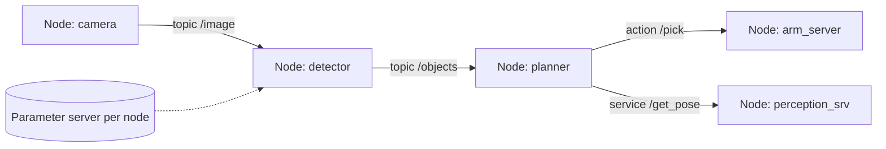

# ROS 2

## Why ROS 2 (vs ROS 1)
| ROS 1 | ROS 2 |
|---|---|
| Custom TCPROS/UDPROS, central **roscore** master (single point of failure) | **DDS** (RTPS) middleware, peer-to-peer discovery, no master |
| No real-time, no QoS | QoS policies, real-time capable executors |
| Python 2 / limited security | Python 3, SROS2 (DDS-Security: authentication, encryption, access control) |
| Linux only | Linux / Windows / macOS / RTOS (micro-ROS) |
| `catkin` | `ament` + `colcon` |
| Nodelets for zero-copy | Composable nodes, intra-process comms, loaned messages |
| Launch XML | Python/XML/YAML launch |

Distros: Humble (22.04, LTS to 2027), Iron, **Jazzy** (24.04, LTS to 2029), Kilted, Rolling. RMW choices: Fast DDS (default Humble), **Cyclone DDS** (default Jazzy+ many), Connext, Zenoh (`rmw_zenoh`, becoming Tier-1 for Kilted/Jazzy+).

## Graph concepts

- **Topic**: async pub/sub, many-to-many, typed messages (`.msg`). **Service**: sync request/response (`.srv`). **Action**: long-running goal + feedback + result + cancel (`.action`; built on topics+services). **Parameter**: node-local, dynamically reconfigurable, with descriptors/callbacks. **Lifecycle (managed) nodes**: `unconfigured → inactive → active → finalized` for deterministic bring-up (used throughout Nav2).
- Commands: `ros2 node|topic|service|action|param|bag|launch|run|interface|doctor|lifecycle|component|control`.

## QoS (very likely asked)
| Policy | Options | Effect |
|---|---|---|
| Reliability | RELIABLE / BEST_EFFORT | retransmit vs drop |
| Durability | VOLATILE / TRANSIENT_LOCAL | late-joiners receive last sample(s) (e.g. `/map`, `/tf_static`) |
| History / Depth | KEEP_LAST(n) / KEEP_ALL | queue |
| Deadline, Lifespan, Liveliness | | monitoring, expiry |
Pub/sub must be **compatible** (publisher reliability ≥ subscriber). Sensor data profile: BEST_EFFORT, depth small. Mismatch is the #1 "why am I not receiving data" cause (`ros2 topic info -v`).

## Executors, callbacks, threading
- `SingleThreadedExecutor` (default), `MultiThreadedExecutor`, `StaticSingleThreadedExecutor`, events executor (lower overhead).
- **Callback groups**: MutuallyExclusive (default) vs Reentrant — needed for a service call inside a callback to avoid deadlock.
- Timers, sub callbacks, service callbacks, wait sets. Don't block in callbacks; use `async` / futures / `spin_until_future_complete` carefully.
- **Composition**: multiple nodes in one process with intra-process zero-copy (`unique_ptr` messages), `rclcpp_components` + `component_container_mt`. Isaac ROS NITROS adds GPU type adaptation.

## TF2 / URDF / Xacro
`tf2_ros::Buffer`, `TransformListener`, `TransformBroadcaster`, `StaticTransformBroadcaster`; frame tree must be a tree (single parent), timestamps/extrapolation errors ("Lookup would require extrapolation into the future") – fix with sim time sync, `waitForTransform`/timeout. `robot_state_publisher` consumes URDF + `/joint_states` → TF. `xacro` macros/params. REP-103 (units: m, rad, s; x forward, y left, z up) and REP-105 (map/odom/base_link).

## ros2_control
Controller manager + hardware interface (`SystemInterface`/`ActuatorInterface`/`SensorInterface` with `read()`/`write()`) + controllers (`joint_state_broadcaster`, `joint_trajectory_controller`, `diff_drive_controller`, `forward_command_controller`, effort/ position/ velocity, admittance_controller). Real-time loop (e.g. 1 kHz) in a SCHED_FIFO thread; command/state interfaces claimed exclusively by controllers; chained controllers; `mock_components`/Gazebo/Isaac hardware plugins for sim.

## Build & workspace
```bash
source /opt/ros/jazzy/setup.bash
mkdir -p ws/src && cd ws/src && ros2 pkg create --build-type ament_python my_pkg --dependencies rclpy std_msgs
cd .. && rosdep install --from-paths src -y --ignore-src
colcon build --symlink-install --packages-select my_pkg && source install/setup.bash
ros2 run my_pkg talker
```
`package.xml` (deps, format 3), `CMakeLists.txt` (`ament_cmake`, `find_package`, `ament_target_dependencies`, `ament_package()`), `setup.py`/`pyproject` for ament_python; overlay vs underlay workspaces; `colcon test`, `ament_lint`, `launch_testing`, `gtest/pytest`.

## Minimal node examples

### Python (rclpy)
```python
import rclpy
from rclpy.node import Node
from rclpy.qos import qos_profile_sensor_data
from sensor_msgs.msg import LaserScan
from geometry_msgs.msg import Twist

class Avoid(Node):
    def __init__(self):
        super().__init__('avoid')
        self.declare_parameter('stop_dist', 0.5)
        self.pub = self.create_publisher(Twist, 'cmd_vel', 10)
        self.sub = self.create_subscription(LaserScan, 'scan', self.cb, qos_profile_sensor_data)

    def cb(self, msg: LaserScan):
        d = min(r for r in msg.ranges if r > msg.range_min)
        cmd = Twist()
        cmd.linear.x = 0.0 if d < self.get_parameter('stop_dist').value else 0.3
        self.pub.publish(cmd)

def main():
    rclpy.init(); rclpy.spin(Avoid()); rclpy.shutdown()
```

### C++ (rclcpp)
```cpp
#include <rclcpp/rclcpp.hpp>
#include <std_msgs/msg/string.hpp>
using namespace std::chrono_literals;

class Talker : public rclcpp::Node {
public:
  Talker() : Node("talker") {
    pub_ = create_publisher<std_msgs::msg::String>("chatter", 10);
    timer_ = create_wall_timer(100ms, [this]() {
      std_msgs::msg::String m; m.data = "hello"; pub_->publish(m);
    });
  }
private:
  rclcpp::Publisher<std_msgs::msg::String>::SharedPtr pub_;
  rclcpp::TimerBase::SharedPtr timer_;
};
int main(int argc, char** argv) {
  rclcpp::init(argc, argv); rclcpp::spin(std::make_shared<Talker>()); rclcpp::shutdown();
}
```

### Launch file (Python)
```python
from launch import LaunchDescription
from launch_ros.actions import Node
def generate_launch_description():
    return LaunchDescription([
        Node(package='my_pkg', executable='talker', name='talker',
             parameters=[{'use_sim_time': True}], remappings=[('chatter', 'my_chatter')]),
    ])
```

### Action server sketch (Python)
```python
from rclpy.action import ActionServer
from example_interfaces.action import Fibonacci
class Srv(Node):
    def __init__(self):
        super().__init__('fib'); ActionServer(self, Fibonacci, 'fibonacci', self.exec)
    def exec(self, goal_handle):
        fb = Fibonacci.Feedback(); seq=[0,1]
        for i in range(1, goal_handle.request.order):
            if goal_handle.is_cancel_requested: goal_handle.canceled(); return Fibonacci.Result()
            seq.append(seq[-1]+seq[-2]); fb.sequence = seq; goal_handle.publish_feedback(fb)
        goal_handle.succeed(); r = Fibonacci.Result(); r.sequence = seq; return r
```

## Ecosystem
**Nav2**, **MoveIt 2**, `slam_toolbox`, `robot_localization`, `ros2_control`, `Gazebo (gz_ros2_control, ros_gz)`, **Isaac ROS** / Isaac Sim ROS2 bridge, `micro-ROS`, `rosbag2` (MCAP storage), `rviz2`, `Foxglove`/`PlotJuggler`, `rqt`, `behaviortree_cpp`, `image_pipeline`, `vision_opencv`, `PlanSys2`, `Open-RMF`, `ros2_tracing` (LTTng), `Zenoh` bridge, `rosbridge`/`foxglove_bridge`, `Autoware`, `ROS-LLM/ros_mcp`.

## Debugging checklist
1. `ros2 topic list/hz/echo/info -v` (QoS!). 2. `ros2 doctor`. 3. `ros2 run tf2_tools view_frames`. 4. `use_sim_time` consistency across all nodes (`/clock`). 5. `RMW_IMPLEMENTATION`, `ROS_DOMAIN_ID`, `ROS_LOCALHOST_ONLY`, firewall/multicast for DDS discovery. 6. Check namespaces & remaps. 7. `rqt_graph`. 8. rosbag record & replay. 9. gdb/valgrind, `ros2 run --prefix 'gdb -ex run --args'`. 10. Tracing & latency (`ros2_tracing`).

## Interview Q&A

**Topic vs service vs action?** Stream vs request/response vs long-running preemptable goal with feedback.

**Why DDS?** Standardized, decentralized discovery, QoS, industrial pedigree; replaces roscore.

**How does intra-process comm work?** Same-process pub/sub passes `unique_ptr` without serialization (needs composition & use_intra_process_comms).

**What is a lifecycle node for?** Deterministic startup/shutdown, configure resources before activate; orchestrated by Nav2 lifecycle manager.

**How to guarantee real-time?** PREEMPT_RT kernel, SCHED_FIFO, memory locking (`mlockall`), pre-allocation, avoid dynamic allocation & locking in RT thread, static executor, ros2_control separate RT loop.

**Why would two nodes not see each other?** Different `ROS_DOMAIN_ID`, network multicast blocked, RMW mismatch, QoS incompatibility, namespace/remap mismatch.

**Migrating ROS1→ROS2?** Use `ros1_bridge` for staged migration; port to rclcpp/rclpy, convert launch & package files, redesign for composition and lifecycle.
