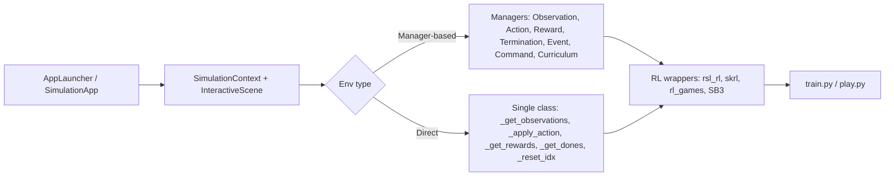

# Isaac Lab

**Isaac Lab** (formerly Orbit; successor to Isaac Gym/IsaacGymEnvs) is an open-source (BSD-3) GPU-accelerated framework for **robot learning** built on Isaac Sim. It provides modular environments for RL, imitation learning, motion planning and sim-to-real, with thousands of parallel environments on one GPU.



## Core abstractions
| Concept | What it is |
|---|---|
| `@configclass` | dataclass-based config system for everything |
| `InteractiveScene` | holds all entities (robots, objects, sensors, terrain) cloned across `num_envs` at spacing `env_spacing` |
| `Articulation` / `ArticulationCfg` | robot with spawn (USD/URDF), initial state, **actuators** |
| `RigidObject`, `DeformableObject`, `AssetBase` | props |
| **Actuators** | `ImplicitActuator` (PhysX PD drive), `IdealPDActuator`, `DCMotorCfg` (torque-speed curve), `ActuatorNetMLP/LSTM` (learned from real data, e.g. ANYmal), `DelayedPDActuator`, `RemotizedPDActuator` — model PD gains, saturation, delay |
| Sensors | `ContactSensor`, `RayCaster` (terrain height scan via warp mesh), `Camera`/`TiledCamera` (batched vision), `Imu`, `FrameTransformer` |
| `TerrainImporter` / `TerrainGenerator` | procedural rough terrain (stairs, slopes, boxes, stepping stones) with difficulty curriculum |
| `SimulationCfg` | `dt`, `render_interval`, `device`, physics material, GPU buffer sizes |
| `DirectRLEnv`, `ManagerBasedRLEnv`, `ManagerBasedEnv`, `DirectMARLEnv` | environment base classes |

### Manager-based workflow
Declarative: define `SceneCfg`, `ObservationsCfg` (groups: `policy`, `critic`), `ActionsCfg` (e.g. `JointPositionActionCfg`, `DifferentialInverseKinematicsActionCfg`, `BinaryJointPositionActionCfg`), `RewardsCfg` (`RewTerm(func=..., weight=...)`), `TerminationsCfg`, `EventCfg` (mode `startup`/`reset`/`interval` — domain randomization such as friction, mass, push), `CommandsCfg` (velocity/pose commands), `CurriculumCfg`. Highly reusable; great for ablations.

### Direct workflow
Write a single env class (closer to IsaacGymEnvs): compute observations/rewards with your own tensor code; faster to iterate on perf-critical tasks; fewer abstractions.

## Typical commands
```bash
# install (conda/venv, Isaac Sim via pip or binary)
git clone https://github.com/isaac-sim/IsaacLab && cd IsaacLab
./isaaclab.sh --install                      # installs extensions + RL libs
./isaaclab.sh -p scripts/tutorials/00_sim/create_empty.py

# train PPO (rsl_rl) on rough-terrain ANYmal-D locomotion, headless, 4096 envs
./isaaclab.sh -p scripts/reinforcement_learning/rsl_rl/train.py \
    --task Isaac-Velocity-Rough-Anymal-D-v0 --num_envs 4096 --headless
# play back trained policy
./isaaclab.sh -p scripts/reinforcement_learning/rsl_rl/play.py --task Isaac-Velocity-Rough-Anymal-D-Play-v0
# list tasks
./isaaclab.sh -p scripts/environments/list_envs.py
```
Task IDs follow `Isaac-<Task>-<Robot>-v0`: e.g. `Isaac-Reach-Franka-v0`, `Isaac-Lift-Cube-Franka-v0`, `Isaac-Open-Drawer-Franka-v0`, `Isaac-Repose-Cube-Allegro-v0`, `Isaac-Velocity-Flat-Unitree-Go2-v0`, `Isaac-Velocity-Rough-H1-v0`, `Isaac-Humanoid-v0`, `Isaac-Cartpole-v0`. (Names/folders shift across releases — run `list_envs.py`.)

## Example reward terms (locomotion)
```python
track_lin_vel_xy_exp = RewTerm(func=mdp.track_lin_vel_xy_exp, weight=1.0,
                               params={"command_name": "base_velocity", "std": 0.5})
track_ang_vel_z_exp  = RewTerm(func=mdp.track_ang_vel_z_exp, weight=0.5, params={"command_name": "base_velocity", "std": 0.5})
lin_vel_z_l2         = RewTerm(func=mdp.lin_vel_z_l2, weight=-2.0)
dof_torques_l2       = RewTerm(func=mdp.joint_torques_l2, weight=-1e-5)
action_rate_l2       = RewTerm(func=mdp.action_rate_l2, weight=-0.01)
feet_air_time        = RewTerm(func=mdp.feet_air_time, weight=0.125, params={"sensor_cfg": SceneEntityCfg("contact_forces", body_names=".*FOOT"), "command_name": "base_velocity", "threshold": 0.5})
```

## RL libraries & algorithms
`rsl_rl` (PPO, ETH — locomotion default), `skrl` (PPO, SAC, TD3, AMP, multi-agent), `rl_games` (PPO, asymmetric actor-critic), `stable-baselines3`, RLinf, Ray/RLlib wrappers. Asymmetric actor-critic (critic sees privileged state); observation noise on the actor only; GAE, large batch (num_envs × horizon), adaptive KL learning-rate schedule, empirical normalization.

## Imitation learning & data
- **Isaac Lab Mimic**: generate large demonstration datasets from few teleop demos (MimicGen-style), with subtask annotation; supports manipulation and humanoid (via GR00T-Mimic / Dexterous variants).
- Teleop devices: keyboard, SpaceMouse, gamepad, Apple Vision Pro / OpenXR hand tracking, Manus/ Quest; record to HDF5 (robomimic-compatible), train BC/diffusion policy via robomimic/LeRobot, evaluate in sim.
- **Isaac GR00T** workflow: collect (teleop + Mimic + Cosmos) → post-train GR00T N-series VLA → evaluate in Isaac Lab / **Isaac Lab-Arena** (policy evaluation framework) → deploy on Jetson Thor.

## Visual RL & sensors
`TiledCamera` renders all envs in a single batched call (big speed-up for vision-based RL); use smaller resolution (e.g. 64–128 px), `--enable_cameras`, teacher-student distillation (privileged state teacher → depth/RGB student), CNN/ViT encoders.

## Sim-to-real in Isaac Lab
- **Actuator modelling**: identified PD gains, armature, friction, torque limits, delays; use actuator-net where available.
- **Domain randomization via EventManager**: `randomize_rigid_body_material`, `randomize_rigid_body_mass`, `randomize_actuator_gains`, `push_by_setting_velocity`, joint-position reset noise, observation noise, action latency, gravity, external forces; terrain curriculum.
- **Deployment**: export policy (`export_policy_as_jit/onnx`), run at policy frequency with same obs ordering/scales; sim2sim test in MuJoCo/Gazebo (common validation step); safety fallbacks.

## Multi-GPU / scaling
`--distributed` multi-GPU training via torchrun, multi-node; num_envs 4096–16384 for locomotion; memory dominated by contacts/terrain/cameras; tune PhysX GPU buffers (`gpu_max_rigid_contact_count`, etc.) when seeing buffer overflow warnings.

## Isaac Lab vs IsaacGymEnvs
| | IsaacGymEnvs (Gym Preview) | Isaac Lab |
|---|---|---|
| Status | deprecated | active |
| Physics/render | PhysX GPU, basic render | PhysX GPU + RTX via Isaac Sim |
| Asset format | URDF/MJCF | USD (+ importers) |
| Structure | monolithic task classes | managers + direct |
| Sensors | limited | cameras, RTX LiDAR, ray-caster, contact, IMU |
| Multi-GPU/vision | limited | tiled rendering, distributed |
| Teleop/IL | none | Mimic, devices, HDF5 |

## Common pitfalls
Wrong action scale (policy outputs offset from default joint pos), observation normalization mismatch at deploy, reward weights dominated by one term, termination not marked as time-out (bootstrap!), too short episode vs command resampling, mismatched joint ordering between sim and hardware, PhysX buffer overflows, low `solver_position_iteration_count` on articulations (jitter), cloning with non-identical assets, sim `dt` vs control decimation inconsistencies, leaking privileged info into the actor.

## Interview Q&A

**Walk me through training a locomotion policy in Isaac Lab.** Choose robot cfg + actuators → terrain generator + curriculum → commands → observations (proprio, gravity projection, commands, last action, height scan for critic/actor) → reward terms (tracking + regularizers) → events (randomization, pushes) → terminations (base contact, orientation) → PPO via rsl_rl with ~4096 envs → evaluate with play script → export → sim2sim → deploy with PD at 200+ Hz.

**Manager-based vs direct?** Manager: modular/declarative, reuse and ablate terms easily. Direct: max control and performance for custom logic.

**How are 4096 environments simulated at once?** Scene cloned in the same physics scene with spacing offsets; `ArticulationView`-style tensor APIs read/write batched states on GPU; envs reset independently via `_reset_idx` with masks.

**What does `decimation` mean?** Policy step = `decimation` physics steps; e.g. dt=0.005, decimation=4 → 50 Hz control.

**Why asymmetric actor-critic?** Critic can use privileged ground-truth, giving better value estimates while the actor only gets deployable observations.

**How do you evaluate sim-to-real transfer?** Sim2sim (different engine), hardware A/B, measure tracking error, energy, falls, compare torque/velocity distributions between sim logs and real logs.
