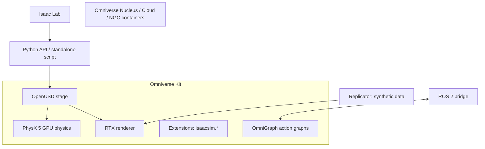

# Isaac Sim

**Isaac Sim** is NVIDIA's robotics simulation application built on **Omniverse (Kit)**. It provides physically based simulation (PhysX 5), RTX-rendered sensors, OpenUSD scene description, ROS/ROS 2 integration, synthetic data generation (Replicator) and a Python API. Source is open on GitHub since the 5.0 generation; check the docs for the exact current version and requirements.

## Architecture

- **USD (Universal Scene Description)**: Pixar's scene format – prims, attributes, relationships, layers/composition (references, payloads, variants), schemas (`UsdPhysics`, `PhysxSchema`). Robots/scenes are `.usd/.usda/.usdc`.
- **Kit extensions**: modules loaded at runtime (`isaacsim.core`, `isaacsim.sensors.*`, `isaacsim.ros2.bridge`, `omni.replicator.core`...). Names were refactored from `omni.isaac.*` to `isaacsim.*` in 4.5/5.0.
- **PhysX 5**: rigid bodies, articulations (reduced coordinate, TGS/PGS solver), GPU pipeline with tensor API (`omni.physics.tensors`), deformables/particles/cloth, joint drives (stiffness/damping/max force), contact reports.
- **Workflows**: GUI app, headless, **standalone Python** (`SimulationApp`), Jupyter, extension workflow, container on cloud GPU (NGC; requires RTX-class GPU — no A100/H100 for rendering since they lack RT cores).

## Installation options
Workstation (Omniverse launcher deprecated → download packaged build / `pip install isaacsim[all,extscache]` for Python env), Docker/NGC container (`nvcr.io/nvidia/isaac-sim`), cloud (AWS/GCP/Azure, Brev, Isaac Automator). Needs recent NVIDIA driver, RTX GPU with ≥ 16 GB VRAM recommended, Ubuntu 22.04/24.04 or Windows.

## Basic standalone script (pattern)
```python
from isaacsim import SimulationApp
simulation_app = SimulationApp({"headless": False})   # must precede other isaac imports

import numpy as np
from isaacsim.core.api import World
from isaacsim.core.api.objects import DynamicCuboid

world = World(stage_units_in_meters=1.0)
world.scene.add_default_ground_plane()
cube = world.scene.add(DynamicCuboid(prim_path="/World/cube", name="cube",
                                      position=np.array([0, 0, 1.0]), size=0.2))
world.reset()
for _ in range(500):
    world.step(render=True)
simulation_app.close()
```
(API module paths changed across versions: older `omni.isaac.core`. Verify against installed version.)

## Importing robots/assets
- **URDF Importer**, **MJCF importer**, ROS URDF via xacro → USD; Onshape; CAD converter. Set articulation root, drive types (position/velocity/effort), stiffness/damping, collision approximations (convex hull/decomposition/SDF mesh), mass/inertia, self-collision.
- Asset library: Nova Carter, Franka, UR, Spot, ANYmal, Unitree (Go2/H1/G1), Jackal, Kaya, humanoid assets, warehouse and SimReady assets on Nucleus/S3.

## Sensors
RGB/depth/normals/instance segmentation/bounding boxes (camera + annotators), **RTX LiDAR** (configurable scan patterns for real sensors – Velodyne, Ouster, Hesai), radar (experimental), **IMU**, **contact sensor**, **effort/joint state**, **ultrasonic/proximity**, stereo, fisheye, optical distortion models, noise models. Camera calibration via OpenCV pinhole/fisheye parameters.

## ROS 2 bridge
`isaacsim.ros2.bridge` publishes/subscribes through OmniGraph nodes: `/clock`, `/tf`, `/joint_states`, `/odom`, `/cmd_vel` (Twist → differential controller), images, camera info, point clouds, LiDAR scans, `/imu`. Requires matching ROS 2 distro libs (Humble/Jazzy; internal bundled libs possible). Use `use_sim_time:=true` everywhere. Integrates with **Nav2**, **MoveIt 2** (via `ros2_control` hardware plugins or joint trajectory), **Isaac ROS** (GPU-accelerated perception: cuVSLAM, nvblox, FoundationPose, NITROS). Be ready to discuss time sync and frame conventions (USD Y-up vs Z-up configuration; ROS REP-103).

## Replicator (synthetic data generation)
Domain randomization at stage/prim level: poses, materials/textures, lights, camera, distractors, physics-based dropping; writers (BasicWriter, KITTI, COCO, custom); scheduling triggers (`on_frame`, `on_time`); outputs RGB, depth, semantic/instance segmentation, 2D/3D boxes, normals, optical flow, point cloud. Use cases: detection/segmentation training (e.g., pallets, boxes), pose estimation, sim-to-real perception. **Cosmos Transfer** augments rendered clips into photorealistic variations; **Cosmos Predict/Reason** are world foundation models.

## OmniGraph / Action graphs
Visual-scripting graphs executed each tick; used for ROS bridging, sensor publishing, controllers (differential, Ackermann, articulation), OmniGraph nodes can be Python scripted.

## Robot control inside Isaac Sim
Articulation controllers (position/velocity/effort), `ArticulationAction`, kinematics solver (Lula: RMPflow, Lula IK, trajectory generator, collision spheres), **cuMotion** (GPU motion planning, based on cuRobo) via MoveIt plugin, grasping workflows, wheeled robots (`WheeledRobot` + `DifferentialController`), manipulation tasks (pick-and-place `PickPlaceController`).

## Digital twins & factory/warehouse
USD-based factory layouts, Omniverse Mega blueprint for fleet simulation, Isaac Sim + Isaac ROS for warehouse AMR testing, multi-robot with Open-RMF integration, CAD/PLC integration, Nucleus collaboration.

## Performance considerations
Headless mode, disable viewport/renders when training; render only needed cameras; reduce RTX settings (rendering mode "performance"), use **tiled rendering** for vision-based RL, physics GPU pipeline + `device='cuda'`, fewer collision meshes (simplify), set `physics_dt` and `rendering_dt` separately, avoid CPU-side per-prim loops (use tensor APIs / views `ArticulationView`, `RigidPrimView`).

## Debugging
Physics debug visualization (collision shapes, contacts, joint axes), console logs (`~/.nvidia-omniverse/logs`), USD composer inspection (Property panel, Stage), `omni.kit.commands`, profilers (Kit Profiler, Nsight), articulation fails (missing root joint, fixed base flag, non-unit scale, zero mass → explosions), "robot flying" due to joint limit or drive mismatch; scaling units (cm vs m: `UsdGeom.GetStageMetersPerUnit`).

## Interview Q&A

**Isaac Sim vs Isaac Lab?** Sim = simulator/application platform (physics, rendering, USD, sensors, ROS bridge). Lab = open-source robot-learning framework built on Sim (RL/IL envs, managers, assets, training scripts).

**Why USD?** Composable, layered, scalable, interoperable scene format with physics schemas, supports collaboration and digital twins.

**Why does Isaac Sim require RTX GPU?** RT cores for ray-traced sensors/rendering; datacenter GPUs lacking RT cores can run headless physics but not RTX rendering.

**How do you bring a custom robot in?** URDF/MJCF → USD, verify articulation, set drive gains from real actuator model, tune inertia/collision, validate vs real data, add sensors, publish through ROS bridge.

**How do you reduce the sim-to-real gap in Isaac Sim?** System-ID of actuators, domain randomization (physics + visual), sensor noise models, delay modelling, calibrate cameras/LiDAR to real sensor configs, Replicator for photometric diversity.

**Isaac Sim ROS 2 bridge tips?** Match distro, set sim time, check TF tree & frame IDs, QoS (sensor data best-effort), ensure OmniGraph is ticked (playing simulation).
